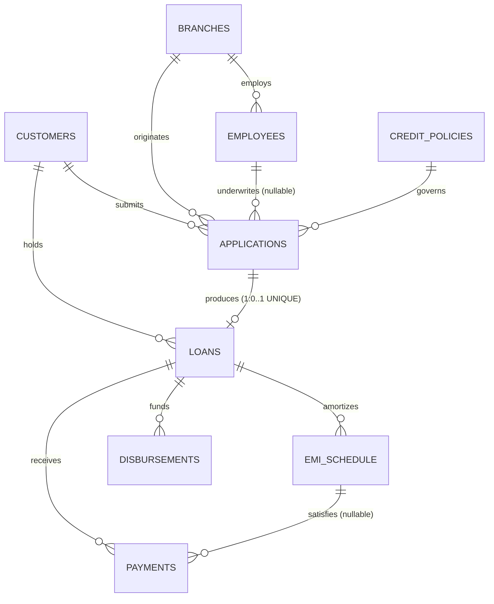

# 🏦 FinLoan Pro — Enterprise Loan Management System (LMS)

[](https://react.dev/)
[](https://nodejs.org/)
[](https://neon.tech/)
[](https://www.chartjs.org/)


**FinLoan Pro** is an institutional-grade, full-stack Banking & Loan Management System engineered on **Neon Cloud PostgreSQL**, **Node.js + Express**, and a modern **React.js 18 + Vite** single-page application (SPA).

The system strictly adheres to the official **Loan Management System – Database Tables, Key Columns & Relationships** reference architecture, featuring reducing-balance financial math, multi-step loan underwriting wizards, interactive DTI appraisal gauges, and executive portfolio dashboards.

---

## 📑 Table of Contents

- [Architectural Overview](#-architectural-overview)
- [Database Architecture (Exactly 9 Tables)](#-database-architecture-exactly-9-tables)
- [Key Features](#-key-features)
- [Technology Stack](#-technology-stack)
- [Project Directory Structure](#-project-directory-structure)
- [API Reference](#-api-reference)
- [Getting Started](#-getting-started)
- [Verification & Automated Tests](#-verification--automated-tests)
- [Security & Compliance](#-security--compliance)

---

## 🏛️ Architectural Overview

```
                        ┌─────────────────────────────────────────┐
                        │      React 18 + Vite Client (SPA)       │
                        │   - 3-Step Loan Wizard & Preset Chips   │
                        │   - Live Amortization & DTI Meter       │
                        │   - Search/Filter Executive Dashboard   │
                        └───────────────────┬─────────────────────┘
                                            │ HTTP / JSON REST
                                            ▼
                        ┌─────────────────────────────────────────┐
                        │        Node.js + Express Server         │
                        │   - Validation Middleware (PAN, DTI)    │
                        │   - Micro-Modular MVC Architecture      │
                        │   - Atomic PostgreSQL Transactions      │
                        └───────────────────┬─────────────────────┘
                                            │ SSL Connection Pool (pg)
                                            ▼
                        ┌─────────────────────────────────────────┐
                        │      Neon Cloud Serverless Postgres     │
                        │   - Exactly 9 PDF-Compliant Tables      │
                        │   - Referential Foreign Key Integrity   │
                        │   - Zero-Balance Loan Amortization      │
                        └─────────────────────────────────────────┘
```

---

## 🗄️ Database Architecture (Exactly 9 Tables)

The database schema strictly conforms to the 9 core tables defined in the reference blueprint:

| # | Table Name | Primary Key | Key Relationships / Purpose |
|---|------------|-------------|-----------------------------|
| 1 | `customers` | `customer_id` | Master customer profile, KYC verification, Indian PAN regex validation, and bureau credit scoring. |
| 2 | `branches` | `branch_id` | Physical banking branches, branch codes, geographic coordinates, and contact details. |
| 3 | `employees` | `employee_id` | Bank underwriting personnel and operations officers. Many-to-One (`branch_id`) with branches. |
| 4 | `credit_policies` | `policy_id` | Credit risk parameters, interest rate bands, tenure bounds, and age/income underwriting limits. |
| 5 | `applications` | `application_id` | Borrower loan requests linked to Customer, Branch, Credit Policy, and optional Employee (`employee_id` is nullable). |
| 6 | `loans` | `loan_id` | Sanctioned credit facilities. Strictly One-to-Zero/One with `applications` (`application_id` is a **UNIQUE** Foreign Key). |
| 7 | `emi_schedule` | `emi_id` | Monthly amortization repayment schedule linked to `loans` (`ON DELETE CASCADE`). Unique `(loan_id, installment_number)`. |
| 8 | `payments` | `payment_id` | Inward repayments (**Borrower → Bank**). Supports regular EMIs as well as unscheduled principal prepayments (`emi_id` is nullable). |
| 9 | `disbursements` | `disbursement_id` | Outward capital releases (**Bank → Borrower**) upon facility underwriting approval with unique transaction references. |

### Entity-Relationship Map



---

## ✨ Key Features

### 1. Smart 3-Step Loan Application Wizard
* **Guided Step Navigation:** Seamlessly segmented into `1. Identity & KYC`, `2. Income & Credit Risk`, and `3. Loan Terms & Configuration`.
* **Quick Presets (Chips):** One-click presets for Facility Amounts (`₹1L`, `₹3L`, `₹5L`, `₹10L`, `₹25L`, `₹50L`) and Tenures (`12M`, `24M`, `36M`, `60M`, `120M`, `240M`) auto-clamped to policy bounds.
* **Instant Policy Eligibility:** Real-time visual comparison of borrower credit score and income against credit policy rules.
* **Institutional Sanction Term Sheet Modal:** Underwriting review dialog styled as a formal bank facility agreement.

### 2. Live Reducing-Balance EMI Appraisal Engine
* **Precision Formula Engine:** Computes monthly obligation via reducing balance math:
  $$\text{EMI} = \frac{P \times r \times (1+r)^n}{(1+r)^n - 1}$$
* **Two-Tone Amortization Split Bar:** Live percentage allocation displaying `% Principal` vs `% Interest` across total repayable amount.
* **Debt-to-Income (DTI) Visual Meter:** Dynamically categorized as:
  * **Safe / Optimal:** $\le 35\%$ (Emerald)
  * **Moderate:** $35\% - 50\%$ (Amber)
  * **Elevated Risk:** $> 50\%$ (Crimson)

### 3. Executive Financial Operations Dashboard
* **Top-Accent KPI Cards:** Live figures for Total Borrowers, Total Disbursed Volume, Outstanding Principal Book, and Overdue Risk.
* **Live Search & Filter Toolbar:** Real-time client-side filtering by borrower name, loan product, transaction mode, and status pills (`All`, `Approved`, `Under Review`, `Rejected`).
* **Interactive Chart.js Visualizations:**
  1. *Monthly Repayment Collections Trend* (Smooth Area Chart)
  2. *Branch Disbursement Volumes* (Categorical Bar Chart)
  3. *Active Portfolio Statuses* (Doughnut Chart)
  4. *Product Category Mix* (Polar Area Chart)

---

## 🛠️ Technology Stack

* **Frontend:**
  * React 18 (Functional Components, Custom Hooks)
  * Vite (Fast HMR & Optimized Production Bundler)
  * React Router DOM v6 (Declarative Client Routing)
  * Chart.js & React-Chartjs-2
  * Custom FinTech Design System with **Plus Jakarta Sans** & **JetBrains Mono**
* **Backend:**
  * Node.js & Express.js (RESTful Micro-Modular MVC Architecture)
  * `pg` (Native PostgreSQL Connection Pooling with SSL)
  * Dotenv, CORS
* **Database:**
  * PostgreSQL 15+ (Serverless Neon Cloud Architecture)

---

## 📁 Project Directory Structure

```text
FinLoan-Pro/
├── backend/
│   ├── config/
│   │   └── db.js                        # PostgreSQL connection pool with SSL
│   ├── controllers/
│   │   ├── applicationController.js     # Applications & Underwriting logic
│   │   ├── dashboardController.js       # KPI metrics & Chart aggregation
│   │   └── loanController.js            # Loans & Amortization schedules
│   ├── middleware/
│   │   ├── errorHandler.js              # Centralized global error handler
│   │   └── validation.js                # PAN regex & financial bounds check
│   ├── routes/
│   │   ├── applicationRoutes.js
│   │   ├── dashboardRoutes.js
│   │   └── loanRoutes.js
│   ├── scripts/
│   │   ├── migrate.js                   # Automated database migration runner
│   │   ├── restore.js                   # Full 13-table recovery utility
│   │   └── testSuite.js                 # Backend unit & financial math tests
│   ├── services/
│   │   └── emiService.js                # Reducing balance formula & DTI engine
│   ├── .env.example                     # Environment template (NO SECRETS)
│   ├── package.json
│   └── server.js                        # Express server & React SPA static server
├── database/
│   ├── migrate_to_pdf_schema.sql        # Non-destructive 9-table migration script
│   ├── original_schema.sql              # Pre-migration schema snapshot
│   ├── schema.sql                       # Clean target 9-table schema
│   └── seed.sql                         # Comprehensive sample banking datasets
├── frontend/
│   ├── dist/                            # Production build output
│   ├── src/
│   │   ├── components/
│   │   │   ├── common/                  # Navbar, Footer, Modal, Alert
│   │   │   ├── dashboard/               # MetricCards, Charts, ActivityTables
│   │   │   └── loan/                    # ApplicationForm, EmiAppraisalCard
│   │   ├── layouts/                     # MainLayout wrapper
│   │   ├── pages/                       # HomePage, DashboardPage, LoanApplicationPage
│   │   ├── routes/                      # React Router configuration
│   │   ├── services/                    # Axios API client wrapper
│   │   ├── styles/                      # FinTech design system CSS
│   │   └── utils/                       # Financial formulas & Chart.js setup
│   ├── scripts/
│   │   └── testFrontend.js              # Frontend unit test suite
│   ├── index.html
│   ├── package.json
│   └── vite.config.js                   # Vite configuration with API proxy
├── frontend_vanilla_backup/             # Archived original vanilla prototype
├── .gitignore                           # Git ignore rules (protects .env & backups)
└── README.md
```

---

## 📡 API Reference

### Health & System Status
* `GET /api/health` — Probe database connectivity, server time, and cluster state.

### Applications & Underwriting
* `GET /api/applications` — List applications with customer and branch details (supports `?status=...&limit=...`).
* `POST /api/applications` — Submit new application (atomic transaction with underwriting validation).
* `GET /api/applications/branches` — List originating bank branches.
* `GET /api/applications/policies` — List credit policies and underwriting criteria.

### Loans & Schedules
* `GET /api/loans` — List active and closed loans with computed monthly EMIs.
* `GET /api/loans/:id` — Retrieve loan details, customer profile, and balance.
* `GET /api/loans/:id/schedule` — Retrieve full installment amortization schedule.

### Financial Dashboard Analytics
* `GET /api/dashboard/stats` — High-level KPI summary cards (Borrowers, Disbursed, Outstanding, Overdue).
* `GET /api/dashboard/charts` — Pre-aggregated Chart.js datasets (Collections, Branches, Mix).
* `GET /api/dashboard/recent` — Recent repayment transactions and loan applications.

---

## 🚀 Getting Started

### 1. Prerequisites
* **Node.js** (v18.x or higher)
* **npm** (v9.x or higher)
* **PostgreSQL Database** (e.g. Neon Cloud Serverless PostgreSQL)

### 2. Clone the Repository
```bash
git clone https://github.com/CrysPy-SAM/AiWise_Financial-Loan-Management-System.git
cd AiWise_Financial-Loan-Management-System
```

### 3. Setup Environment Variables
Create `backend/.env` based on `backend/.env.example`:
```env
PORT=5050
NODE_ENV=development
DATABASE_URL=postgresql://<user>:<password>@<neon-host>/<dbname>?sslmode=require
```

### 4. Install Dependencies
```bash
# Install backend dependencies
cd backend
npm install

# Install frontend dependencies
cd ../frontend
npm install
```

### 5. Initialize Database (Optional for fresh setup)
```bash
psql $DATABASE_URL -f database/schema.sql
psql $DATABASE_URL -f database/seed.sql
```

### 6. Run the Application

#### Option A: Full Production Mode (Express serves React SPA)
```bash
# Build React client
cd frontend
npm run build

# Start backend server
cd ../backend
npm start
```
* Access Application: [http://localhost:5050](http://localhost:5050)
* Loan Wizard: [http://localhost:5050/loan-application](http://localhost:5050/loan-application)
* Executive Dashboard: [http://localhost:5050/dashboard](http://localhost:5050/dashboard)

#### Option B: Development Mode (Vite HMR + Express API)
```bash
# Terminal 1: Backend API
cd backend
npm run dev

# Terminal 2: Vite Dev Server
cd frontend
npm run dev
```
* Vite Dev Server: [http://localhost:3000](http://localhost:3000) (Proxies `/api` to port `5050`).

---

## 🧪 Verification & Automated Tests

Run the comprehensive unit and integration test suites:

### 1. Frontend Financial Math & Validation Tests
```bash
npm --prefix frontend test
```
* Tests reducing balance monthly EMI precision ($₹16,251.22$).
* Tests Indian PAN 10-character alphanumeric regex (`^[A-Z]{5}[0-9]{4}[A-Z]{1}$`).
* Tests INR Indian numbering system formatting ($₹5,00,000$).
* Tests Debt-to-Income (DTI) risk thresholds.

### 2. Backend Financial Logic & Zero-Balance Schedule Tests
```bash
npm --prefix backend test
```
* Verifies exact 36-month amortization reduction ending in $₹0.00$ remaining balance.
* Verifies loan underwriting policy limits.

### 3. Frontend Bundle Production Verification
```bash
npm --prefix frontend run build
```
* Verifies zero warnings/errors in the production bundle compilation.

---

## 🔒 Security & Compliance

* **Zero Credentials Committed:** `.env` files and database backups containing customer PII are strictly excluded via `.gitignore`.
* **SSL In-Transit Encryption:** All database pool connections require TLS encryption (`sslmode=require`).
* **Input Sanitization & Parameterization:** 100% of database queries utilize PostgreSQL parameterized queries (`$1`, `$2`), eliminating SQL injection vulnerabilities.
* **Integrity Constraints:** Foreign keys enforce referential integrity with strict `RESTRICT` and cascading policies.

---

## 📄 License
This project is open-source and licensed under the [MIT License](LICENSE).
